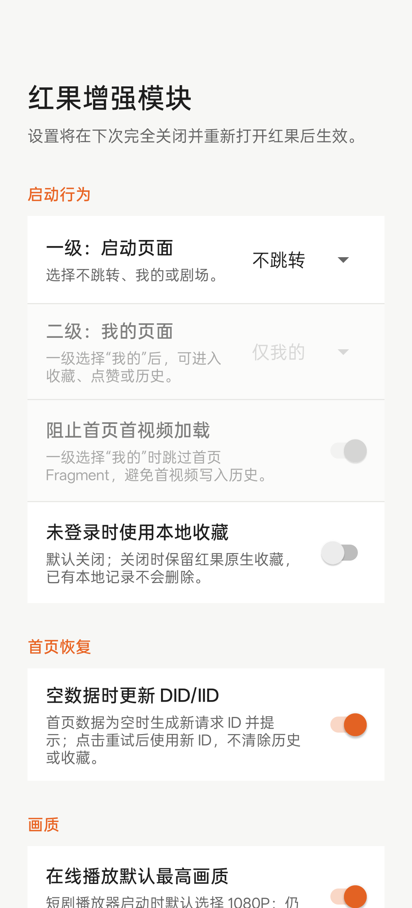
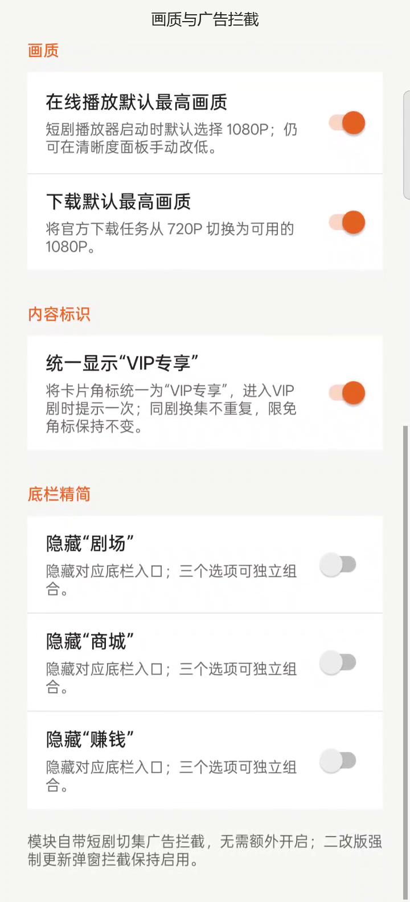
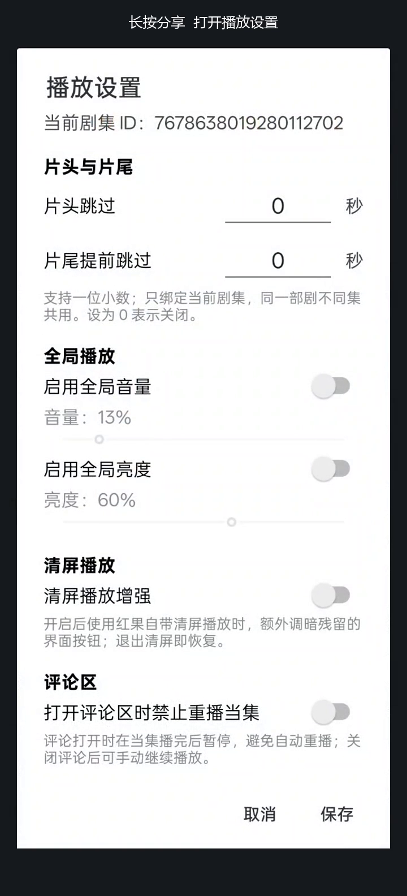

# 红果视频增强模块（HongguoCache1080）

适配红果短剧 `com.phoenix.read` 7.3.9.32 的 LSPosed 模块，使用官方 LSPosed 1.9.2 兼容的 legacy XposedBridge API。当前模块版本为 **1.8.7**。

## 展示视频

<a href="media/HongguoCache1080-v1.8.7-showcase.mp4"></a>

[观看约 50 秒的功能展示视频](media/HongguoCache1080-v1.8.7-showcase.mp4)。录屏拍摄于 Root 测试机：独立模块设置页为 v1.8.7，红果播放页当时运行的免 Root Integrated 包内嵌 v1.8.6 模块。画面展示设置和可见 UI，不作为独立 Root Hook 的隔离验收结果。

## 设置界面

| 启动与首页 | 画质与界面 | 播放设置 |
| --- | --- | --- |
|  |  |  |

Root 模块从桌面打开「红果增强模块」设置。播放页长按「分享」打开播放设置；普通点击仍由红果原版处理。修改设置后，完全关闭并重新打开红果以读取新配置。

## 功能说明

### 画质与下载

- **在线播放默认最高画质**：播放器启动时选择当前版本提供的 `ExtremelyHigh`（1080P）。用户之后仍可在红果清晰度面板手动改低；开关可独立关闭。
- **下载默认最高画质**：创建离线下载任务时，把默认 `SuperHigh`（720P）改为 `ExtremelyHigh`（1080P）。模块补齐该分辨率在任务数据库中的序列化和回读；首次替换时显示一次提示。实际可用清晰度仍取决于剧集资源。

### 启动、首页与收藏

- **两级启动位置**：一级可选「不跳转 / 我的 / 剧场」，默认不跳转。选「我的」后，二级可选「仅我的 / 收藏 / 点赞 / 历史」；也可启用「阻止首页首视频加载」，避免初始视频写入历史。选择「剧场」时会保留剧场底栏入口。
- **首页空数据时更新 DID/IID**：默认开启。确认首页主响应的 `data` 为空后，生成随机 16 位请求 ID，并仅替换后续 `/bookmall/tab/` 请求 URL 中的 `device_id` 和 `iid`；不清除登录态、历史、本地收藏或 SDK 已注册身份。提示后需要点击重试；一分钟内重复空响应不会连续轮换。这是请求参数恢复尝试，不能保证创建新游客或长期解决首页异常。
- **未登录本地收藏**：默认关闭。开启且红果明确判定未登录时，播放页星标、选集收藏及「我的→收藏」使用本机列表；可打开剧集或长按列表项移除。登录后沿用红果原版收藏。关闭开关保留本地记录，但清除红果应用数据会删除它们；记录不与账号同步。模块不接管点赞。

### 播放体验

- **按剧跳过片头片尾**：在播放设置中分别输入片头和片尾秒数，支持 0.1 秒精度；同一部剧不同集共用。实际跳过时显示无背景的短提示，并在原生进度条标出位置。设置为 0 表示关闭。
- **音量与亮度**：各有独立开关和调节值，仅在红果播放界面应用；离开播放界面后恢复进入前的值。
- **评论区防重播**：评论弹层打开且当前视频匹配时，完播后暂停并阻止同集自动重播；关闭评论后仍可手动继续播放。该功能可独立关闭。
- **清屏播放增强**：默认关闭。启用后使用红果自带清屏播放时，把残留按钮和进度条调暗至约 22% 透明度；退出原生清屏后恢复。

### 界面与广告

- **VIP 标识**：可把普通 VIP 短剧卡片的角标显示为「VIP专享」，进入 VIP 剧时提示一次剧类型；限时免费角标保持原样。同一部剧换集不重复提示。
- **底栏精简**：可分别隐藏「剧场」「商城」「赚钱」入口，三个开关独立，默认关闭。
- **切集广告**：对已分析版本的竖屏短剧与横版短剧 OneStop 广告页插入点直接跳过广告项，不修改下一集数据；广告请求仍可能发生，其他广告路径和实际横屏换集效果尚未完整实测。
- **特定二改版提示拦截**：按文本特征关闭注入的强制更新弹窗，并阻止完整匹配的“不安全”Toast；不处理普通登录、隐私或下载确认提示。

功能依赖红果短剧 7.3.9.32 的具体类和方法。红果更新后，部分 Hook 可能失效；横屏换集广告、其他红果版本和 Android 版本仍需分别实测。首页空数据时更新 DID/IID 不能保证长期恢复首页服务。

## 安装

1. 从 [v1.8.7 Release](https://github.com/T8numen/HongguoCache1080/releases/tag/v1.8.7) 下载独立模块 APK，并安装红果短剧 7.3.9.32。
2. 在 LSPosed Manager 中启用模块，作用域只选择 `com.phoenix.read`。
3. 完全关闭并重新打开红果。桌面上的「红果增强模块」可调整启动页面、本地收藏等设置；在播放页长按「分享」可打开播放设置。

## 构建

使用 JDK 17 和 Android SDK 37。在 `android-app` 目录运行：

```powershell
.\gradlew.bat :app:assembleDebug
```

输出位于 `android-app/app/build/outputs/apk/debug/`。模块入口为 `assets/xposed_init`，Xposed API 以 `compileOnly` 方式依赖 `de.robv.android.xposed:api:82`。

仓库只包含模块源码和构建配置，不包含红果短剧 APK、免 Root 整合包、签名私钥或用户数据。此项目与红果短剧官方无关。

## 版本与更新记录

当前源码对应 **v1.8.7**。[当前模块 APK](https://github.com/T8numen/HongguoCache1080/releases/tag/v1.8.7) 与 [25 个历史模块 APK](https://github.com/T8numen/HongguoCache1080/releases/tag/module-apk-history) 分别放在 GitHub Releases；旧版 APK 是历史构建存档，仓库源码不对应旧版构建。文件名带 `debug`，表示这些 APK 来自 Gradle 的 debug 构建。

| 版本 | 主要变更 |
| --- | --- |
| 1.8.7 | 启动位置改为两级选择，可进入我的、剧场以及收藏、点赞、历史；本地收藏增加默认关闭的开关。 |
| 1.8.6 | 首页主响应为空时可更新请求用 DID/IID；该功能默认开启，启动直达默认关闭。 |
| 1.8.5 | 增加横版短剧 OneStop 广告页插入拦截，并在设置页说明广告拦截。 |
| 1.8.4 | 补齐全屏播放器的评论区完播回调拦截。 |
| 1.8.3 | 片头片尾跳过提示改为透明背景文字；增加竖屏短剧 OneStop 广告页插入拦截。 |
| 1.8.2 | 本地收藏的剧名可从当前剧详情补取。 |
| 1.8.1 | 修复未登录收藏入口跳登录、评论区同集重播和进度条标记位置。 |
| 1.8.0 | 首次加入未登录时的本地收藏与「我的→收藏」列表；此版部分入口仍存在已知问题。 |
| 1.7.1 | 清屏增强改为配合红果原生清屏使用；修复设置读取的临时失败兜底。 |
| 1.7.0 | 片头片尾改为 0.1 秒精度，增加跳过提示和进度条位置标记。 |
| 1.6.0 | 长按分享打开播放设置，加入按剧片头片尾跳过、音量和亮度调节。 |
| 1.5.6 | 拦截特定二改版延迟显示的不安全 Toast。 |
| 1.5.5 | 清理诊断 Hook；此版仍可能显示延迟不安全 Toast。 |
| 1.5.2–1.5.4 | 历史诊断构建，用于签名和错误码排查，不建议日常使用。 |
| 1.5.1 | 内嵌设置入口提示改为每次创建主界面显示一次。 |
| 1.5.0 | 增加免 Root Integrated 运行时识别及应用内设置入口。 |
| 1.4.1 | 增加 VIP 专享角标和进入 VIP 剧的类型提示。 |
| 1.3.2 | 修复冷启动时首页预创建的拦截时机。 |
| 1.3.0–1.3.1 | 增加在线播放默认最高画质，并修复桌面冷启动路由判断。 |
| 1.2.0 | 增加启动直达「我的→收藏」、阻止首页首视频加载和模块设置页。 |
| 1.1.0 | 增加特定二改版强制更新弹窗拦截。 |
| 1.0.2 | 修复 1080P 下载任务分辨率的持久化与回读。 |
| 1.0.1 | 下载分辨率首次替换时显示一次提示。 |
| 1.0.0 | 初始版：把下载任务从 720P 调整到 1080P。 |

历史版本用于回溯，不建议直接覆盖新版。设置键和适配行为随版本变化；安装前请核对目标红果版本及 LSPosed 作用域。
